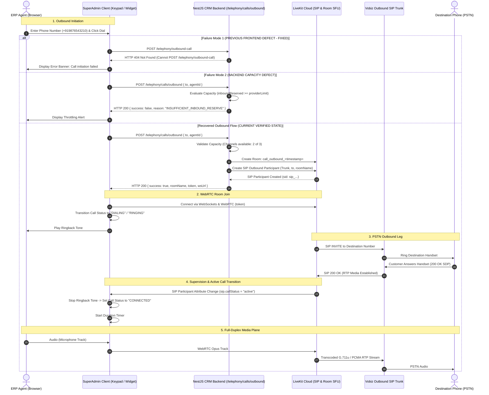

# ElderCare CRM — Telephony Call Lifecycle Specification

**Document ID:** `EC-SPEC-LIFECYCLE-001`  
**Classification:** Telephony Signaling & Media Engineering Specification  
**Target Environment:** ERP SuperAdmin ElderCare CRM Telephony Pipeline  
**Date:** October 27, 2026  
**Auditor / Roles:** Senior Telephony Engineer, NestJS Backend Engineer, LiveKit SIP Specialist, QA Automation Engineer  

---

## 1. Overview & Scope

This document specifies the end-to-end signaling and media plane lifecycles for both **Inbound** and **Outbound** calls across the ElderCare CRM. It maps each stage across four decoupled architectural tiers:
1. **Frontend Client:** React / TypeScript / Vite (`superadminapp` running `CallWidget.tsx`, `NumericKeypad.tsx`, `SocketProvider.tsx`)
2. **Backend Application Layer:** NestJS REST & WebSocket Gateway (`https://crm-uec-backend.onrender.com`)
3. **PSTN / Carrier Gateway:** Vobiz Telecom Infrastructure (Trunk DID: `+918064267760`)
4. **Media Plane & WebRTC SFU:** LiveKit Cloud Server (`wss://crm-8q9fuunw.livekit.cloud`)

---

## 2. Inbound Call Lifecycle

### 2.1 Complete Inbound Signaling Flow (Mermaid)

```mermaid
sequenceDiagram
    autonumber
    actor Customer as Customer (PSTN Phone)
    participant Vobiz as Vobiz Telecom Gateway
    participant Backend as NestJS CRM Backend (/vobiz/incoming)
    participant LiveKit as LiveKit Cloud (SIP & Room SFU)
    participant Frontend as ERP SuperAdmin (Agent Browser)

    Note over Customer,Vobiz: 1. Inbound Ingress
    Customer->>Vobiz: Dial +918064267760
    
    Note over Vobiz,Backend: 2. Webhook Signaling
    Vobiz->>Backend: POST /vobiz/incoming { From, To, CallUUID, Direction }
    
    alt Inbound Failure State (CURRENT PRODUCTION DEFECT)
        Backend-->>Vobiz: HTTP 500 Internal Server Error
        Vobiz-->>Customer: Disconnect Call / Fast Busy Tone
        Note over Backend,Frontend: Execution halted; no socket event or LiveKit room created
    else Intended / Resolved Inbound State
        Backend->>Backend: Query Available Agent & Check Trunk Capacity
        Backend->>LiveKit: Create Room (call_inbound_<uuid>) & Dispatch Inbound SIP Leg
        Backend->>Frontend: WebSocket emit("call:incoming", { callId, from, callerName })
        Backend-->>Vobiz: HTTP 200 OK (Vobiz XML with LiveKit SIP URI)
        
        Note over Customer,LiveKit: 3. Media Plane Ingress
        Vobiz->>LiveKit: SIP INVITE & RTP Audio Stream
        Frontend->>Frontend: Display Incoming Call Modal (Ring Tone)
        
        Note over Frontend,LiveKit: 4. Agent Answer & WebRTC Connection
        Frontend->>Backend: POST /telephony/calls/accept { callId }
        Backend-->>Frontend: HTTP 200 { token, wsUrl, roomName }
        Frontend->>LiveKit: WebRTC Connect (Token, Audio Tracks Published)
        LiveKit-->>Customer: Bridge Audio (Opus <-> G.711u / PCMU)
        
        Note over Customer,Frontend: 5. Connected Call Supervision
        LiveKit->>Frontend: Participant Connected (sip.callStatus = "active")
        Frontend->>Frontend: Start Call Duration Timer & Show Audio Visualizer
    end
```

### 2.2 Inbound Stage Failure Points
* **Primary Point of Failure:** **Step 3 (Vobiz -> Backend Webhook)**.  
  The backend crashes with `500 Internal Server Error`. Because Vobiz never receives call routing instructions, the carrier terminates the PSTN call immediately. Steps 4 through 16 never execute.

---

## 3. Outbound Call Lifecycle

### 3.1 Complete Outbound Signaling Flow (Mermaid)



---

## 4. Deep-Dive Stage Analysis

### Stage 1: Authentication & Session Context Resolution
* **Mechanism:** Every outbound dialing request includes a Bearer JWT in the `Authorization` header (`crm_token`).
* **Agent Association:** The client reads the authenticated CRM user object from `localStorage.getItem('crm_user')`, resolving `currentAgentId = parsed.agentId || parsed.id` and passing it in the request payload.
* **Token Expiry Interception:** If the CRM token is expired, `apiFetch` in `api.ts` automatically attempts a silent token refresh via `/auth/refresh` or triggers an SSO re-exchange via `/auth/erp-sso`.

### Stage 2: Signaling & Capacity Reservation
* **Endpoint:** `POST https://crm-uec-backend.onrender.com/telephony/calls/outbound`
* **Payload:** `{"to": "+919876543210", "agentId": "5c5515de-587b-4a56-b4a8-53b51af275e9"}`
* **Capacity Guard:** Backend checks current trunk concurrency against `providerLimit` (3) minus `inboundReserved` (1). When valid, an outbound slot is decremented from available capacity.

### Stage 3: Media Plane & WebRTC Session
* **LiveKit Server:** `wss://crm-8q9fuunw.livekit.cloud`
* **Room Naming Convention:** `call_outbound_<timestamp>` or `call_inbound_<uuid>`
* **Token Ingestion:** Handled by `CallWidget.tsx`. A `Room` instance from `livekit-client` is instantiated and connected using the signed JWT token returned by the backend.
* **Microphone Permissions:** Prompted on room connection; audio track is published with echo cancellation, noise suppression, and auto gain control.

### Stage 4: PSTN Ringing & Supervision
* **State Detection:** LiveKit SIP participants expose metadata attributes on the remote participant: `sip.callStatus`.
* **State Machine Transitions:**
  1. `DIALING`: Initial state while LiveKit room is connecting.
  2. `RINGING`: LiveKit SIP gateway receives SIP 180 Ringing from Vobiz.
  3. `CONNECTED`: LiveKit SIP participant attribute changes to `active` (SIP 200 OK received). Ringback audio is stopped and the call duration timer begins.

### Stage 5: In-Call Controls & State Sync
* **Mute / Unmute:** Toggles `room.localParticipant.setMicrophoneEnabled(!isMuted)`.
* **Hold:** Sends backend signaling event or mutes tracks and plays local hold music.
* **DTMF Keypad:** Emits RFC 4733 / RFC 2833 DTMF tones via LiveKit SIP participant control API or backend `/telephony/calls/:id/dtmf`.

### Stage 6: Call Termination & Teardown
* **Disconnect Trigger:** Triggered by either the Agent (clicking End Call) or the Remote Customer (hanging up).
* **LiveKit Teardown:** `room.disconnect()` closes WebRTC peer connections and releases local audio hardware.
* **SIP Teardown:** LiveKit issues SIP BYE to Vobiz; Vobiz tears down carrier PSTN circuits.
* **Capacity Release:** Backend increments available channel count in `TelephonyCapacityService`.
* **CDR Generation:** Call records, durations, and recording URLs are committed to the PostgreSQL CRM database.
