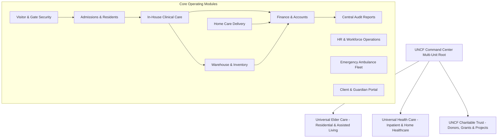

# UNCF SuperAdmin ERP — Complete Module Inspection & Verification Guide

> **Client & Auditor Handbook**  
> **Platform:** UNCF Command Center (Universal Nature Care & Cure Foundation)  
> **Version:** Production Enterprise Release (2026)  
> **Target Audience:** Client Executive Team, Operations Leads, Auditors, and System Administrators

---

## 1. Executive Architecture & Multi-Unit Framework

The UNCF SuperAdmin ERP is a unified command center managing charitable trusts, inpatient healthcare, assisted elder care, home health delivery, supply chain, and workforce operations.



### The Multi-Unit Switcher
In the top navigation bar, the active facility selector controls data scope:
* **All Units (Facility-wide):** Aggregated command view across all physical campuses and divisions.
* **Universal Elder Care (`UEC`):** Filtered exclusively to residential senior care, elder boarding, and geriatric care.
* **Universal Health Care (`UHC`):** Filtered to clinical inpatient, outpatient, and home healthcare services.

---

## 2. Standard Series ID Reference Table

Every transactional entity generated by the ERP adheres to an authoritative 4-digit serial numbering standard:

| Prefix & Series | Business Meaning | Typical Generated Example | Found In Module |
|---|---|---|---|
| `ELD-YYYY-XXXX` | Elder Care Resident Identifier | `ELD-2026-0001` | Admissions, Care, Billing |
| `PAT-YYYY-XXXX` | General Hospital / Clinic Patient | `PAT-2026-0042` | Admissions, Ambulance |
| `ADM-YYYY-XXXX` | Admission Case / Episode File | `ADM-2026-0001` | Admissions, Relieving |
| `VIS-YYYY-XXXX` | Visitor & Contractor Security Pass | `VIS-2026-0001` | Visitor & Security |
| `REQ-YYYY-XXXX` | Internal Stock / Medicine Requisition | `REQ-2026-0001` | Inventory, Nursing Care |
| `MNT-YYYY-XXXX` | Facility Repair & Maintenance Ticket | `MNT-2026-0001` | HR Operations, Logistics |
| `PO-YYYY-XXXX` | Purchase Order to Supplier | `PO-2026-0001` | Inventory Procurement |
| `GRN-YYYY-XXXX` | Goods Receipt Note (Inward Inflow) | `GRN-2026-0001` | Warehouse Inward Receiving |
| `RET-YYYY-XXXX` | Supplier Debit / Return Note | `RET-2026-0001` | Warehouse Outward Return |
| `BILL-XXXX` | Accounts Payable Vendor Bill | `BILL-0001` | Finance P2P 3-Way Match |
| `UEC-INV-YYYY-XXXX` | Official Elder Care Monthly Statement | `UEC-INV-2026-0001` | Finance, Resident Billing |
| `UHC-HOME-INV-XXXX` | Home Healthcare Service Invoice | `UHC-HOME-INV-0012` | Home Care, Finance |
| `REC-YYYY-XXXX` | 80G Tax Exemption Donation Receipt | `REC-2026-0512` | Donors & Foundation |
| `DNR-YYYY-XXXX` | Permanent Charitable Donor Number | `DNR-2026-0012` | Donors & Foundation |
| `EMP-XXXX` | Employee Workforce ID | `EMP-1001` | HR Operations |

---

## 3. Module-by-Module Verification Guide

---

### Module 1: Admissions & Resident Onboarding (`/admission`)

#### Business Purpose
Manages resident registration, clinical intake priority, room/bed allotment, guardian portal provisioning, and relieving/discharge clearance.

#### Tabs & Capabilities
1. **Admissions Register:** Live list of active inpatients, room/bed coordinates, admission dates, and clinical condition.
2. **Add / Admit Resident:** Wizard to admit from prior enquiries or register fresh admissions with consent documents.
3. **Historical Archive:** Discharged and archived resident dossiers with searchable clinical and billing timelines.
4. **Relieving & Discharge Clearance:** Multi-department checkout sign-off (Medical, Finance, and Asset clearance).

#### Step-by-Step Client Verification Workflow
1. Navigate to **Admissions** in the sidebar.
2. Click **Admit Resident** or **Fast-Track Onboard**.
3. Fill in:
   * Patient Name, Age, Gender, Primary Contact.
   * Admitting Unit (e.g. `Universal Elder Care`).
   * Room allotment (e.g. `Room 204`, `Bed A`).
   * Clinical Condition (e.g. `Assisted Ambulatory`, `Mild Dementia`).
4. Click **Confirm Admission**.
5. **Verify:**
   * Record immediately appears in the active table with a standardized Case Number (`ADM-2026-XXXX`).
   * Elder Resident profile receives an official ID (`ELD-2026-XXXX`).
   * Guardian portal credentials can be provisioned on the spot.

#### Cross-Module Verification Check
* **Check In-House Care (`/inhouse-care`):** The new resident immediately appears in the Nurse's Daily Care Roster, Vital Signs Monitor, and Medicine Schedule.
* **Check Finance (`/finance`):** The resident appears in the Elder Billing patient lookup dropdown.

---

### Module 2: In-House Care & Clinical Operations (`/inhouse-care`)

#### Business Purpose
Direct operational console for chief medical officers, nurses, and caregivers to record vitals, administer prescriptions, track activities of daily living (ADL), log incidents, and request pharmacy supplies.

#### Tabs & Capabilities
1. **Daily Operations & Checklist:** Shift-by-shift checklists (Morning/Evening) for Vitals, Medication, ADL, and Nutrition.
2. **Clinical Assignments:** Staff duty assignments linking specific nurses to residents and wards.
3. **Vital Signs Monitoring:** Systolic/Diastolic BP, Pulse, Temperature, SpO2, and Blood Glucose tracker with abnormal alert triggers.
4. **Medication Administration Record (MAR):** Scheduled drug timeslots, dosage, verification flags, and route administration logs.
5. **ADL & Nutrition:** Hygiene, feeding, mobility status, caloric intake, and special diet adherence.
6. **Incidents & Safety:** Clinical falls, behavioral escalation, or medical emergency incident documentation.
7. **Medicine Requisitions:** Ward-level internal requisition requests dispatched to the medical pharmacy warehouse.
8. **Critical Alerts:** Real-time triage monitor highlighting patients requiring urgent medical attention.

#### Step-by-Step Client Verification Workflow
1. Navigate to **In-House Care** $\rightarrow$ **Vital Signs** tab.
2. Click **Record Vitals** for any resident.
3. Enter `BP: 125/82`, `Pulse: 74 bpm`, `Temp: 98.4 F`, `SpO2: 99%`.
4. Click **Save Vitals Record**.
5. **Verify:**
   * Entry appears in the historical trend chart with timestamp and nurse signature.
   * If an abnormal value is deliberately entered (e.g. `SpO2: 88%`), the resident immediately flags in **Monitoring & Alerts** as `CRITICAL / NEEDS ATTENTION`.
6. Switch to **Medicine Requisitions** $\rightarrow$ Click **Request Consumable / Medicine**.
7. Select resident, pick `Paracetamol 500mg`, set `Qty: 10`, click **Submit Requisition**.
8. **Verify:** A new requisition is created with sequential number `REQ-2026-XXXX`.

#### Cross-Module Verification Check
* **Check Inventory (`/inventory` $\rightarrow$ Stock Issue Requests):** The requisition `REQ-2026-XXXX` appears instantly in the warehouse manager's approval queue.
* **Check Client Portal (`/portal`):** The recorded vitals show up in real-time on the family member's portal dashboard.

---

### Module 3: Home Care & Community Healthcare (`/home-care`)

#### Business Purpose
End-to-end management of community home healthcare: client leads/enquiries, service contracts, caregiver scheduling, home visit delivery, timesheets, and monthly home care service billing.

#### Tabs & Capabilities
1. **Manager Overview:** Live home care KPIs: active contracts, active shifts, unallocated requests, and billing projections.
2. **Service Contracts:** Legal care agreements, billing frequency (Monthly/Per-visit), assigned hours, and monthly tariffs.
3. **Client Directory:** Roster of community clients receiving home care nursing, physiotherapist visits, or companion attendants.
4. **Care Delivery & Vitals:** Field notes, blood sugar records, and home treatment reports submitted by visiting nurses.
5. **Manager Roster:** Interactive calendar showing caregiver duty allocations across morning, evening, and night shifts.
6. **Enquiries & Intake:** Inbound care request triage (Emergency, Converted, Open) with automated intake forms.
7. **My Visits & Timesheets:** GPS-ready check-in/check-out logs of assigned staff completing patient visits.

#### Step-by-Step Client Verification Workflow
1. Navigate to **Home Care** $\rightarrow$ **Enquiries** tab.
2. Click **Log New Enquiry** (e.g. Patient: *Ramesh Kumar*, Service: *Post-stroke rehabilitation*, Frequency: *Monthly*).
3. Click **Convert to Contract** in the enquiry actions.
4. Enter Contract Start Date, Monthly Service Fee (e.g. `₹25,000`), and assign a registered Nurse.
5. Click **Activate Contract**.
6. **Verify:** Contract is created with number `CON-2026-XXXX`.
7. Go to **Manager Roster**: Verify that the nurse's shift block is populated with the patient's home address and duty hours.

#### Cross-Module Verification Check
* **Check Finance (`/finance` $\rightarrow$ Manual Billing):** Click **Select Inpatient / Home Care**, choose the home care client. The system pre-fills the monthly fee, home address, and client details under prefix `UHC-HOME-INV-XXXX`.

---

### Module 4: Warehouse & Procurement Inventory (`/inventory`)

#### Business Purpose
Full supply chain management across both **Medical** and **Food & Provisions** domains: product catalog, FEFO (First-Expired, First-Out) lot tracking, purchase order procurement, goods receipt note (GRN) inward receiving, supplier returns, and physical audits.

#### Tabs & Capabilities
1. **Inventory Overview:** High-level valuation, stock-out warnings, expiring batches, and daily movement graph.
2. **Domain Switcher:** Toggle between **Medical Pharmacy & Consumables** and **Kitchen Provisions & Food Rations**.
3. **Product Master:** Item directory, SKU codes (`MED-PCM-500`), unit of measure, minimum reorder thresholds, and default revenue pricing.
4. **Stock Batches & Lots:** Live lot balances, batch numbers (`LOT-2026-01`), expiry dates, and unit cost breakdowns.
5. **Stock Issue Requests:** Requisitions from wards (`REQ-2026-XXXX`) ready for review, approval, and FEFO stock deduction.
6. **Stock Movements Ledger:** Immutable chronological audit trail of all receipts, issues, supplier returns, and adjustments.
7. **Purchases & Procurement:**
   * **Purchase Orders (PO):** Supplier orders (`PO-2026-XXXX`).
   * **Goods Receipt Notes (GRN):** Inward receiving vouchers (`GRN-2026-XXXX`) with delivery challan and invoice attachment.
   * **Supplier Returns (RET):** Damaged/rejected return debits (`RET-2026-XXXX`).
8. **Physical Audits:** Blind cycle counts, variance calculations (System vs Physical), and reconciliation postings (`AUD-2026-XXXX`).
9. **Vendor Directory:** Certified suppliers with contact details, payment terms, and vendor codes (`VEN-PHARM-01`).

#### Step-by-Step Client Verification Workflow
1. Navigate to **Inventory** $\rightarrow$ **Purchases & Procurement**.
2. Click **Create Purchase Order**:
   * Vendor: `MedPlus Logistics`.
   * Item: `Surgical Gloves Box 100s`, Qty: `50`, Unit Price: `₹250`.
   * Click **Save PO**.
   * **Verify:** PO appears as `PO-2026-XXXX` in `DRAFT` status.
3. Click **Transition to Ordered**: Vendor receives order.
4. Click **Receive Delivery (GRN)**:
   * Enter Delivery Challan No: `DC-8841`.
   * Supplier Invoice No: `INV-2026-99`.
   * Enter Batch No: `LOT-2026-GLV`, Expiry Date: Future date.
   * Accepted Qty: `50`, Rejected: `0`.
   * Click **Submit Goods Receipt**.
5. **Verify:**
   * System generates `GRN-2026-XXXX`.
   * Stock lot balance in **Stock Batches** increases by exactly 50 units.
   * **Stock Movements Ledger** registers an inward movement with balance update.

#### Cross-Module Verification Check
* **Check Finance (`/finance` $\rightarrow$ Accounts Payable / P2P):** The GRN appears automatically under **GRN Accruals** ready for 3-way matching against the vendor's bill (`BILL-XXXX`).

---

### Module 5: Finance, Billing & General Ledger (`/finance`)

#### Business Purpose
Comprehensive financial headquarters handling resident billing, cashbox petty cash, accounts receivable, procure-to-pay (P2P) accounts payable, bank reconciliation, automated monthly recurring billing, and GST compliance.

#### Two Operating Perspectives
Use the top perspective switcher:
1. **Elder Universal Billing:** Resident and patient billing, manual bill generators, printable PDFs, UPI scannable QR codes, and WhatsApp invoice dispatch.
2. **Accounts & General Ledger:** Complete double-entry financial controls, cashbox ledger, accounts payable, bank reconciliation, and tax filings.

#### Tabs & Capabilities
1. **Elder Billing:** One-click monthly fee invoicing per resident with itemized boarding, medicine, and therapy breakdown.
2. **Manual & Emergency Billing:** Customizable itemized billing with GST calculation, customizable payment UPI QR code, printable bill generator, and direct WhatsApp invoice dispatch.
3. **Cashbox & Petty Cash Ledger:** Real-time cashbox receipts (`RCP-2026-XXXX`), expense vouchers, and cashier balance totals.
4. **Patient Daily Expense Ledger:** Unbilled clinical services, doctor visit charges, and consumables pending billing (`COST-2026-XXXX`).
5. **Procure-to-Pay (P2P) Accounts Payable:**
   * 3-Way Matching: Verifies PO $\leftrightarrow$ GRN $\leftrightarrow$ Vendor Bill.
   * Variance detection for price and quantity discrepancies.
   * Vendor Bill approval (`BILL-XXXX`) and GL posting.
6. **Bank Reconciliation:** Upload or paste bank statement lines (UTR, amount, date) with auto-matching against ledger invoices and bills.
7. **Monthly Recurring Billing:** One-click batch run generating hundreds of monthly boarding invoices for all eligible admitted residents in under 2 seconds.
8. **GST Tax Compliance & E-Invoice:** Summary of CGST/SGST/IGST breakdown, HSN code sales summary, and CSV/JSON export for tax portals.

#### Step-by-Step Client Verification Workflow
1. Navigate to **Finance** $\rightarrow$ **Elder Universal Billing** $\rightarrow$ **Manual Billing**.
2. Select resident `ELD-2026-0001`.
3. System automatically populates resident name, age, room, and plan details.
4. Enter Line Items:
   * Room Boarding: `₹20,000`
   * Nursing Care: `₹5,000`
   * Medicine Consumables: `₹1,850`
5. Click **Generate Authoritative Bill**.
6. **Verify:**
   * Bill generated under official series: `UEC-INV-2026-XXXX`.
   * Scannable UPI QR code displays with correct total (`₹26,850`).
   * Clicking **Download PDF** generates formatted, branded PDF with UNCF Trust authorization.
   * Clicking **Send via WhatsApp** opens pre-composed itemized WhatsApp message with billing summary.
7. Click **Record Payment**: Mode: `UPI`, Ref: `UTR9938102941`. Bill status changes to `PAID`.

#### Cross-Module Verification Check
* **Check Cashbox / Ledger:** A credit transaction appears in the General Ledger under `TXN-2026-XXXX`.
* **Check Client Portal (`/portal`):** The invoice appears in the family member's **Invoices & Receipts** tab marked `PAID`.

---

### Module 6: HR Operations & Workforce Management (`/hr-operations`)

#### Business Purpose
Workforce directory, biometric/attendance tracking, shift rosters, leave governance, candidate recruitment pipelines, facility maintenance ticketing, and client portal provisioning.

#### Tabs & Capabilities
1. **HR Overview:** Workforce counts, on-duty staff today, pending leave requests, open operational tasks, and pending facility tickets.
2. **Workforce Directory:** Active doctors, nurses, administrative officers, drivers, and caregivers with employee IDs (`EMP-XXXX`).
3. **Attendance & Shift Rosters:** Check-in / check-out times, present/absent/half-day statuses, and department shift assignments.
4. **Leave Governance:** Leave applications, leave balance checks, and administrative approval/rejection workflows.
5. **Recruitment & Payroll:** Candidate tracking pipeline (Applied, Interview, Offered, Placed) and automated monthly payroll calculation preview.
6. **Operational Tasks Register:** Campus maintenance, patient assistance, and facility tasks with priority flags (`TSK-2026-XXXX`).
7. **Facility Maintenance:** Physical equipment, electrical, plumbing, and vehicle repair tickets with standardized series (`MNT-2026-XXXX`).
8. **Client Portal Access Governance:** Reset guardian PINs, toggle family portal access, and audit last logins.

#### Step-by-Step Client Verification Workflow
1. Navigate to **HR Operations** $\rightarrow$ **Facility Maintenance** tab.
2. Click **Log Issue**:
   * Issue Type: `Plumbing & Water Supply`
   * Priority: `URGENT`
   * Location: `Room 204 Bathroom - Valve leakage`
   * Click **Submit Maintenance Ticket**.
3. **Verify:** Ticket is created in the table with official ticket number `MNT-2026-XXXX`.
4. Click **Resolve Issue**:
   * Technician: `CoolTech Air & Water`
   * Parts Replaced: `Brass 0.5-inch valve`
   * Cost: `₹450`
   * Click **Mark as Resolved**.
5. **Verify:** Ticket transitions from `PENDING` to `RESOLVED` with green badge and audit timestamp.

---

### Module 7: Visitor, Gate & Security Operations (`/visitor-security`)

#### Business Purpose
Campus gate security control, visitor pass generation with OTP verification, commercial delivery vehicle entry/exit tracking, staff duty trips, and resident outing logging.

#### Tabs & Capabilities
1. **Security Command Dashboard:** Active visitor headcounts currently inside the campus, vehicles on premises, and residents outside on outings.
2. **Visitor Passes:** Visitor registration, digital gate pass issuance (`VIS-2026-XXXX`), purpose tagging (Doctor, Relative, Contractor), host notification, and checkout stamping.
3. **Gate Check-In Queue:** Rapid verification queue for expected guests, delivery drivers, and scheduled visitors.
4. **Vehicle Movements:** Commercial goods vehicle check-in, delivery challan verification, vehicle registration number tracking, and exit recording.
5. **Staff Duty Trips:** Short official staff exits (pharmacy run, home care visit, emergency lab drop) with vehicle and return monitoring.
6. **Resident Outings:** Resident permissions to leave premises with family members, recording expected return time, wheelchair equipment, and overdue return alarms.

#### Step-by-Step Client Verification Workflow
1. Navigate to **Visitor & Security** $\rightarrow$ **Visitor Passes** tab.
2. Click **Issue New Visitor Pass**.
3. Enter Visitor Phone: `9876543210`, Name: `Suresh Narayanan`, Category: `RESIDENT_VISITOR`.
4. Host Resident: Select `ELD-2026-0001`, Purpose: `Family Weekend Visit`.
5. Click **Verify OTP & Issue Pass**.
6. **Verify:**
   * Visitor Pass appears in the table with standardized series number: `VIS-2026-XXXX`.
   * Status shows `ACTIVE / CHECKED_IN`.
   * "Currently Inside Premises" counter increases by 1 on the Security Dashboard.
7. When visitor leaves: Click **Check-Out** $\rightarrow$ Pass status changes to `COMPLETED / CHECKED_OUT`, departure timestamp recorded, active count decrements.

#### Cross-Module Verification Check
* **Check Resident Outings:** If the resident went with the visitor, logging an outing in **Resident Outings** automatically links to the resident's profile and displays `Elder ID: ELD-2026-0001`.

---

### Module 8: Donors, Grants & Volunteer Foundation (`/donors-volunteers`)

#### Business Purpose
Non-profit foundation management: permanent donor profiles, 80G tax-exempt charitable donation receipts, project funding allocations, grant disbursements, payment vouchers, and volunteer initiatives.

#### Tabs & Capabilities
1. **Foundation Overview:** Year-to-date collections, 80G tax receipts issued, active welfare projects, and total grant disbursements.
2. **Donations Register:** Searchable register of all received contributions, payment modes (UPI, Cheque, NEFT), prayer requests, and printable 80G receipts (`REC-2026-XXXX`).
3. **Donor Directory:** Profiles of individual, family, and corporate CSR donors (`DNR-2026-XXXX`) with total lifetime contributions.
4. **Project Financials:**
   * Project master (Elder Subsidy Fund, Free Medical Camps, Nutrition Relief).
   * Funding allocations from donations to specific projects.
   * Expenditure tracking and Payment Vouchers (`PV-2026-XXXX`).
5. **Volunteers & Community:** Volunteer database, skill categories (Doctors, Field Assistants, Event Coordinators), and active assignments.

#### Step-by-Step Client Verification Workflow
1. Navigate to **Donors & Volunteers** $\rightarrow$ **Donations Register** tab.
2. Click **Record New Donation**:
   * Donor Name: `Sundaram Finance CSR Foundation`
   * Amount: `₹1,00,000`
   * Mode: `BANK_TRANSFER` (NEFT Ref: `UTR8829104`)
   * Purpose: `Elder Care Nutrition & Medicine Subsidy`
   * Section 80G Tax Exemption: `Checked (Yes)`
   * Click **Issue Donation Receipt**.
3. **Verify:**
   * Official receipt issued with number `REC-2026-XXXX`.
   * Donor registered under `DNR-2026-XXXX`.
   * Printable 80G certificate drawer opens with trust registration number `NGO/REG-2021/80G-11029`.
4. Go to **Project Financials** $\rightarrow$ Allocate `₹50,000` to `Elder Subsidy Fund` $\rightarrow$ System logs allocation and adjusts available balance.

---

### Module 9: Emergency Ambulance Dispatch & Fleet (`/ambulance`)

#### Business Purpose
Emergency medical fleet management: real-time ambulance vehicle availability, emergency trip dispatching, patient pickup/drop-off coordinates, odometer (KM) tracking, and emergency billing.

#### Tabs & Capabilities
1. **Fleet Overview:** Available, on-trip, and maintenance vehicle counts, active emergency requests, and daily dispatch counts.
2. **Vehicle Fleet:** Vehicle registration numbers, vehicle types (BLS - Basic Life Support, ALS - Advanced Life Support), oxygen cylinder status, and base locations.
3. **Trip Dispatch Register:** Emergency trip tickets (`TRIP-2026-XXXX`), priority levels (Normal, Urgent, Emergency), driver allocations, and completion logs.
4. **Driver & Staff Rosters:** Certified emergency medical technicians (EMTs) and ambulance drivers on duty.

#### Step-by-Step Client Verification Workflow
1. Navigate to **Ambulance** $\rightarrow$ **Trip Dispatch Register** tab.
2. Click **New Trip Request**:
   * Caller Name & Mobile: `9845012345`
   * Priority: `EMERGENCY`
   * Pickup: `Campus Ward 2B`, Destination: `GKNM Super Specialty Hospital`
   * Patient: Select resident or enter UHID.
3. Click **Dispatch Ambulance**:
   * Select available vehicle (e.g. `TN 38 BH 1089`)
   * Assign Driver and EMT.
4. Click **Confirm Dispatch** $\rightarrow$ Trip status transitions to `DISPATCHED`.
5. On return: Click **Complete Trip**, enter start KM (`14,210`) and end KM (`14,238`) $\rightarrow$ Total KM and charges calculated automatically.

---

### Module 10: Client & Family Guardian Portal (`/portal`)

#### Business Purpose
External web portal for family members, sons/daughters, and legal guardians to monitor their admitted elder's care in real time, view vitals charts, check daily meal plans, inspect medicine schedules, view bills, and submit feedback or special requests.

#### Accessible Route
Publicly accessible portal URL: `https://your-erp-domain.org/portal/login`  
*(Test Login: Guardian registered mobile number + assigned 6-digit PIN)*

#### Tabs & Capabilities
1. **Resident Overview:** Resident room, bed number, attending physician, and general wellness status.
2. **Live Vitals Monitor:** Charts for BP, Pulse, Temperature, Blood Sugar, and oxygen saturation updated by nurses.
3. **Prescriptions & Medicines:** Active medication schedules, dosages, and daily administration timestamps.
4. **Nutrition & Meals:** Breakfast, lunch, snack, and dinner menus with dietary restrictions.
5. **Daily Expense Ledger:** Itemized daily expenses incurred (special dressings, lab tests, physiotherapy).
6. **Invoices & Statements:** Download official bill PDFs (`UEC-INV-2026-XXXX`) and view payment receipt acknowledgments.
7. **Complaints & Requests:** Submit requests (e.g. *Request extra blanket*, *Schedule video call*).

#### Step-by-Step Client Verification Workflow
1. Open a new incognito window and visit `/portal/login`.
2. Login with registered guardian phone number and PIN.
3. Resident profile displays with room details and photo.
4. Switch to **Vitals Chart**: Verify that the vitals entered in Module 2 (Care) appear instantly on the guardian's graph.
5. Switch to **Invoices**: Verify that the invoice generated in Module 5 (Finance) is visible for download.

---

### Module 11: Central Audit Reports & Cross-Domain Validation (`/reports`)

#### Business Purpose
Executive management and audit intelligence workspace offering cross-domain data integrity validation, scheduled report generation, CSV/PDF exporting, and deep audit traces across all 10 modules.

#### Tabs & Capabilities
1. **Cross-Domain Workflow Auditor:** Automated health check verifying whether foreign keys and cross-module linkages are intact (e.g. Admissions linked to Care, Invoices linked to Patients, GRNs linked to POs).
2. **Finance & Revenue Reports:** Collections by payment mode, outstanding debtor balances, and daily ledger turnover.
3. **Inventory & Warehouse Reports:** Stock consumption by category, expiring batches within 30/60/90 days, and stock valuation breakdown.
4. **Admissions & Resident Care Reports:** Occupancy rates, average length of stay, clinical priority distribution, and discharge clearances.
5. **HR & Workforce Reports:** Attendance percentage by department, overtime, and pending leave analytics.
6. **Home Care Reports:** Active contracts, revenue by service tier, and caregiver utilization ratios.
7. **Visitor & Security Reports:** Peak visitor traffic hours, average visit duration, and vehicle gate logs.
8. **Donors & Funding Reports:** Year-over-year donation growth, 80G tax utilization, and project allocation balances.

#### Step-by-Step Client Verification Workflow
1. Navigate to **Reports** in the sidebar.
2. Click **Cross-Domain Workflow** tab.
3. Click **Run System Health & Integrity Audit**.
4. The system validates:
   * That 100% of admissions have valid patient and unit linkages.
   * That all inventory issue requisitions match live lot balances.
   * That no invoices have orphaned patient IDs or negative balances.
5. Select any report tab (e.g. **Admissions Care Reports**), set Date Range: `This Month`, click **Export CSV**.
6. **Verify:** CSV file downloads containing formatted identifiers (`ADM-2026-XXXX`, `ELD-2026-XXXX`).

---

## 4. End-to-End Operational Walkthrough Scenarios

Share these 3 complete cross-module journeys with the client to demonstrate real-world integration:

### Journey A: The Elder Care Resident Lifecycle
```
[Enquiry / Intake]  --> [Admit Resident: ADM-2026-0001 & ELD-2026-0001]
                               |
                               v
               [Care Workspace: Daily Vitals & MAR]
                               |
                               v
            [Nursing Medicine Requisition: REQ-2026-0001]
                               |
                               v
           [Warehouse: Deducts FEFO Lot in Inventory]
                               |
                               v
        [Finance: Generates Monthly Bill UEC-INV-2026-0001]
                               |
                               v
          [Family Portal: Guardian views vitals & pays bill]
                               |
                               v
        [Relieving & Discharge: Medical, Finance & Asset Sign-off]
```

---

### Journey B: The Complete Supply Chain & Procurement Cycle
```
[Department Requisition: REQ-2026-0001] --> [Low Stock Threshold Alert]
                                                   |
                                                   v
                                   [Purchase Order: PO-2026-0001]
                                                   |
                                                   v
                              [Warehouse Receiving: GRN-2026-0001]
                                                   |
                                                   v
                           [Batch Lot Created: LOT-2026-01 with Expiry]
                                                   |
                                                   v
                         [Finance P2P: 3-Way Match vs BILL-0001]
                                                   |
                                                   v
                               [General Ledger Payment Voucher: PAID]
```

---

### Journey C: Security Gate Check-In to Departure
```
[Visitor arrives at Gate] --> [Security records Phone & Photo]
                                     |
                                     v
                        [OTP Sent & Verified by Host]
                                     |
                                     v
                        [Gate Pass Issued: VIS-2026-0001]
                                     |
                                     v
                   [Dashboard: Active Visitors inside incremented]
                                     |
                                     v
                 [Visitor departs -> Security clicks Check-Out]
                                     |
                                     v
                [Visitor Pass COMPLETED & Out-timestamp audited]
```

---

## 5. Verification Checklist for Client Sign-Off

Use this final checklist during the client inspection demonstration:

- [ ] **Multi-Unit Switching:** Toggle between `All Units`, `Universal Elder Care`, and `Universal Health Care`. Verify tables and headers re-scope dynamically.
- [ ] **Sequential IDs:** Verify that newly created records show clean serial IDs (`ELD-2026-XXXX`, `ADM-2026-XXXX`, `VIS-2026-XXXX`, `REQ-2026-XXXX`, `MNT-2026-XXXX`) and zero raw sliced UUIDs.
- [ ] **FEFO Inventory Deductions:** Approve a stock requisition and confirm that the earliest-expiring batch is decremented first in the ledger.
- [ ] **Printable Statements & QR Codes:** Generate a manual bill in Finance, inspect the UPI QR code, print/download the PDF, and test the WhatsApp dispatch link.
- [ ] **Family Portal Synchronization:** Record a vital sign in In-House Care and confirm it displays instantly in the Client & Guardian Portal.
- [ ] **Cross-Domain Integrity:** Run the automated audit report in the Central Reports module to confirm 100% data consistency.
