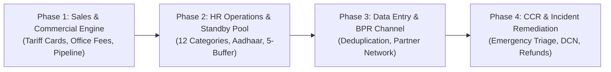

# Client SOP Implementation & Phased Execution Recommendations

**Phase:** SOP-01 — Client SOP Mapping & ERP Gap Analysis  
**Date:** October 15, 2026  
**Document Status:** Strategic Roadmap & Phased Implementation Plan  
**Target Applications:** SuperAdminApp, Backend, and Cross-App Ecosystem  
**Governance Constraint:** Read-only inspection complete; execution sequence prepared for client approval prior to code edits.

---

## 1. Executive Strategy & Phasing Philosophy

The gap analysis across the four client SOP documents (`HR SOP`, `DATA ENTRY SOP`, `SALES TEAM FINAL SOP`, `CCR SOP`) demonstrated that the underlying Prisma database schema is robust and already possesses ~90% of the required relational entities (`Staff`, `Candidate`, `Enquiry`, `Client`, `Allocation`, `Complaint`, `ReferralPartner`, `FollowUp`).

However, the user interfaces (primarily inside `SuperAdminApp` and `CRMApp`) have operational blind spots:
1. Standard client tariffs and office service fees are not automated.
2. The 12 client-defined staff categories are represented as generic free text rather than strict taxonomies.
3. Multi-stage gates (TLM commercial approval, 3-way conference calls, DCN dispatch, 3-day post-placement checks) lack structured visual UI triggers.

To implement these SOP enhancements safely without destabilizing existing ERP workflows, regression-breaking existing modules, or corrupting live probe data, a **4-Phase Sequenced Rollout** is recommended.

---

## 2. Phased Implementation Roadmap

---

### Phase 1: Commercial Sales Pipeline & Standard Tariff Engine
* **Target Module:** `superadminapp/src/features/home-care/` (Enquiry & Quotation Desk)
* **Rationale:** The sales team drives the top-line revenue target (₹5,00,000/month baseline). Enforcing fixed standard tariffs and office service charges immediately eliminates revenue leakage and pricing inconsistencies.
* **Key Deliverables:**
  1. *Tariff Card Selector:* Auto-populating monthly caregiver fees (Patient Care ₹25k/₹28k, Nursing Care ₹35k–₹40k, Baby Care ₹25k/₹35k, Doctor/Physio min ₹300/day).
  2. *Office Service Charge Calculator:* 1 month (₹7,500), 3 months (₹15,000), 6 months (₹18,000), 8 months (1 month salary equivalent).
  3. *Approval Gateway:* TLM commercial sign-off before quotation dispatch.
  4. *3-Way Conference Checkpoint:* Checkbox & call note log mandatory prior to moving enquiry to `ALLOCATED`.
* **Prerequisites & Dependencies:** None. Utilizes existing `Enquiry` and `Client` database models.
* **Estimated Complexity:** Low–Medium.

---

### Phase 2: HR Talent Acquisition & 12-Category Standby Buffer Engine
* **Target Module:** `superadminapp/src/features/hr-operations/`
* **Rationale:** Sales cannot fulfill contracts without a reliable, verified pool of caregivers. Automating the 12 SOP categories and alerting on standby deficits ensures staff availability for immediate deployment.
* **Key Deliverables:**
  1. *12-Category Taxonomy:* Replace generic category text fields with the official SOP categories (`Female Attender`, `Male Attender`, `Baby Care`, `NICU`, `ANM & GNM`, `BSC Nursing`, `Certificate Nurse`, `Emergency Staff`, `Office Staff`, `Cook`, `Maid`, `House Keeping`).
  2. *Aadhaar & KYC Document Collector:* Upload widget with verification status pill (`PENDING_VERIFICATION`, `VERIFIED`, `REJECTED`).
  3. *5-Standby Backup Monitor:* Dashboard widget tracking ready staff per category and flagging alerts when available count < 5.
  4. *72-Hour Post-Placement Staff Welfare Log:* Automated Day 1, 2, and 3 check-in tracker.
* **Prerequisites & Dependencies:** Phase 1 (enables seamless handoff between sales contract type and matching HR staff category).
* **Estimated Complexity:** Medium.

---

### Phase 3: Data Entry Ingestion, Deduplication & BPR Channel Network
* **Target Module:** Cross-Domain (`home-care`, `hr-operations`, `central-reports`)
* **Rationale:** Clean data prevents duplicate outreach, prevents staff record collisions, and tracks referral commissions for healthcare partners.
* **Key Deliverables:**
  1. *Real-Time Deduplication Shield:* In-line phone and Aadhaar collision detection preventing duplicate leads and duplicate staff profiles.
  2. *BPR Partner Directory & Attribution:* Linking enquiries to partner categories (`Ambulance`, `Physio`, `Hospital`, `Lab`) using the existing `ReferralPartner` Prisma model.
  3. *Wanted Staff List Alarm Widget:* Daily operational overview showing which staff profiles must be aggressively sourced by HR recruiters.
* **Prerequisites & Dependencies:** Phase 2 staff categories and Phase 1 enquiry records.
* **Estimated Complexity:** Low–Medium.

---

### Phase 4: CCR Incident Remediation, Rapid Replacement & Refund Handoff
* **Target Module:** `superadminapp/src/features/reports/` or Dedicated `Customer Care` View
* **Rationale:** Client retention and zero-complaint service delivery require structured escalation, rapid replacement dispatch, and clean dispute settlement.
* **Key Deliverables:**
  1. *Priority Complaint Desk:* Classification by `EMERGENCY` (< 2h SLA), `NORMAL` (24h SLA), and `ABNORMAL` (12h SLA).
  2. *Rapid Replacement Dispatcher:* One-click query of HR Standby Pool to assign substitute staff and auto-generate the DCN (Delivery Confirmation Note).
  3. *Priority Refund Gateway:* Formal handoff from CCR to Finance Manager queue with pro-rata usage calculator.
  4. *Post-Resolution Review & Testimonial Scheduler:* Feedback trigger for 4.5+ star ratings to schedule client testimonial video.
* **Prerequisites & Dependencies:** Phase 1 (client contract data), Phase 2 (standby staff pool), and Phase 3 (clean customer records).
* **Estimated Complexity:** Medium–High.

---

## 3. Risk Assessment & Mitigation Strategies

| Risk Identified | Impact | Probability | Mitigation Strategy |
|---|---|---|---|
| **Database Schema Drift** | High | Low | **Zero schema modification** during initial UI refinements. All SOP requirements can be accommodated using existing Prisma models and JSON metadata fields. |
| **Breaking Standalone Apps (`CRMApp`, `HRApp`)** | Critical | Low | Preserve all backend API endpoints and shared models. Additive UI changes only within `SuperAdminApp`. |
| **Probe Data Corruption** | Critical | None | All 28 existing test probe records identified in Phase 19A2 will remain strictly protected and unedited. |
| **Sales Friction from Strict Tariff Lock** | Medium | Medium | Implement an "Override with TLM Approval" toggle so exceptional cases do not cause sales bottlenecks. |
| **Overlapping 3-Day Follow-Up Overhead** | Medium | Medium | Provide a single consolidated "Follow-Up Timeline" accessible to both HR and Care Coordinators. |

---

## 4. Immediate Recommended Action

1. **Client Review & Sign-Off:** Review Deliverable 3 (`docs/SOP_CLIENT_CLARIFICATIONS.md`) with stakeholders to finalize the 6 open policy questions (especially Tariff Overrides and CRM domain placement).
2. **Execute First Testing Phase (Phase 1):** Validate current `home-care` quotation and allocation flow against Test Cases `SL-01` and `SL-02` from `docs/SOP_MANUAL_TEST_PLAN.md`.
3. **Begin Phase 1 Implementation:** Implement the standard tariff auto-calculator and Office Service Charge dropdowns in `HomeCareWorkspace.tsx` once authorized.
