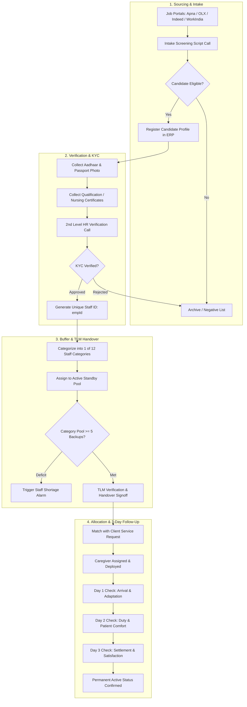
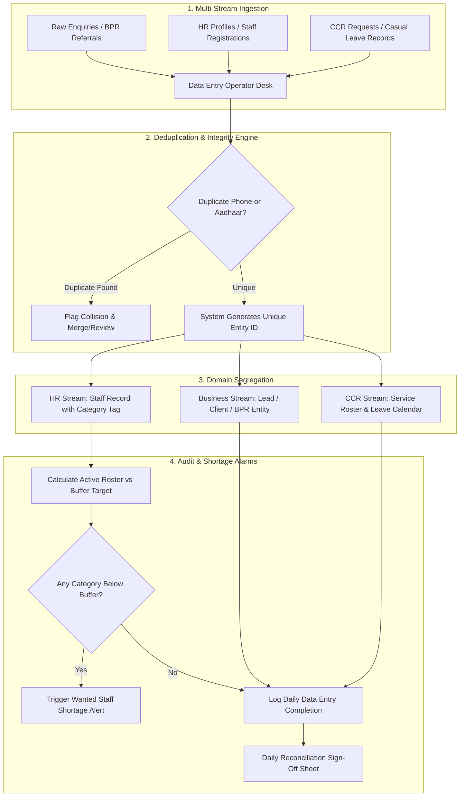
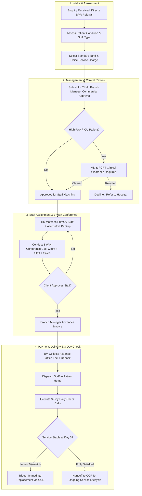
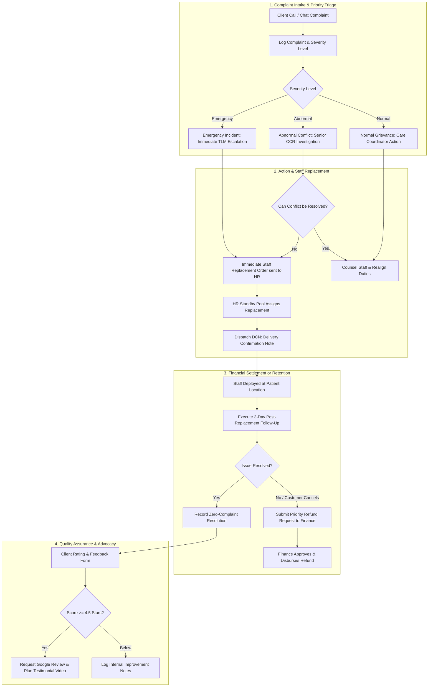

# Client SOP Workflow Maps & Cross-Domain Flow Documentation

**Phase:** SOP-01 — Client SOP Mapping & ERP Gap Analysis  
**Date:** October 15, 2026  
**Status:** Audit & Architecture Baseline  
**Scope:** Read-Only Analysis across SuperAdminApp, Backend, and Client SOP Documents  
**Source SOPs:**
1. `HR SOP AND REPORT SHEET.docx`
2. `DATA ENTRY SOP 2026.docx`
3. `SALES TEAM FINAL sop.docx`
4. `CCR SOP.docx`

---

## 1. HR Recruitment-to-Handover Workflow

### 1.1 Process Narrative
The client HR SOP defines a rigorous end-to-end talent acquisition and staff deployment pipeline designed to maintain an active roster of 12 distinct staff categories with a target buffer of 35 verified staff:
1. **Sourcing & Application Intake:** Candidate profiles are sourced from portals (Apna, OLX, Indeed, WorkIndia) and direct referrals into the ERP Candidate pool.
2. **First-Level Phone Screening:** Initial qualification via standardized calling script (current location, 24-hr duty readiness, salary expectation, patient handling experience).
3. **Identity Verification & Document Collection:** Aadhaar card, photograph, police clearance, and nursing certificates collected.
4. **Second-Level HR Verification:** Senior HR/Team Lead confirms candidate authenticity, assigns unique `empId`, and conducts background check.
5. **Team Leader (TLM) Handover & Standby Buffer:** Minimum of 5 standby backup staff maintained per category for immediate emergency deployment. Handover record signed by HR, TLM, and Admin.
6. **Post-Placement 3-Day Follow-Up:** Continuous checking on staff welfare, punctuality, and client satisfaction for 72 hours post-joining.

### 1.2 Mermaid Workflow Diagram



### 1.3 ERP Architectural Mapping & Touchpoints
- **Frontend Workspace:** `superadminapp/src/features/hr-operations/HrOperationsWorkspace.tsx`
  - Existing: Staff directory table, add staff modal, role assignments.
  - Required Extension: Candidate pipeline stages, 12-category dropdown taxonomy, Aadhaar document upload & verification badge, 5-standby buffer monitor.
- **Backend Model:** `Backend/prisma/schema.prisma` (`Staff`, `Candidate`, `Interview`, `StaffDocument`)
- **Cross-Domain Handoff:** Handover from HR pool into `HomeCare` allocations table (`Allocation.staffId`).

---

## 2. Data Entry & Daily Verification Workflow

### 2.1 Process Narrative
The Data Entry SOP governs the integrity and synchronization of all incoming business data, personnel records, and customer care files across three primary operational streams:
1. **Business Data Stream:** Ingestion of fresh leads, legacy customer archives, BPR (Business Partner Referral) networks, and marketing channel tagging (OG, HC, TP, DNR).
2. **HR Data Stream:** Synchronization of applicant details across the 12 defined staff categories, updating negative blacklist entries, and compiling Monthly Performance Records (MPR).
3. **CCR Data Stream:** Logging active customer roster, deployed staff rosters, casual leaves (CL), and roster calendars.
4. **Audit & Deduplication:** Pre-save phone number and Aadhaar duplicate validation.
5. **Shortage Alarm Engine:** Comparing current active standby staff counts against target buffers (Wanted Staff List) and alerting operations leaders.

### 2.2 Mermaid Workflow Diagram



### 2.3 ERP Architectural Mapping & Touchpoints
- **Frontend Workspaces:**
  - `HrOperationsWorkspace.tsx`: Staff list, validation.
  - `HomeCareWorkspace.tsx`: Enquiry list, Client list.
  - `CentralReportsWorkspace.tsx`: Daily operational logs and MPR.
- **Backend Controllers:**
  - `hr.controller.ts`: Unique employee ID validation, category filtering.
  - `homeCare.controller.ts`: Unique client phone deduplication.
  - `referralPartner.controller.ts`: BPR category records.

---

## 3. Sales Enquiry-to-Service Delivery Workflow

### 3.1 Process Narrative
The Sales SOP establishes a 10-stage disciplined commercial cycle targeting minimum ₹5,00,000 monthly team throughput:
1. **Intake & Requirement Assessment:** Lead received (Direct, BPR, or Campaign), patient clinical condition evaluated, service type chosen (Patient Care, Nursing Care, Baby Care, Doctor/Physio visit).
2. **Standard Tariff & Service Charge Quotation:** System generates fixed monthly staff fee (e.g. ₹25k–₹40k) plus mandatory upfront Office Service Charge (1 mo ₹7,500, 3 mo ₹15,000, 6 mo ₹18,000, 8 mo 1 month salary equivalent).
3. **TLM / Branch Manager Approval:** Commercial terms and discounts (if any) approved by designated authority before presenting final proposal.
4. **MD & Patient Care Review Team (PCRT) Clearance:** Clinical feasibility and safety review for critical/intensive patient cases.
5. **HR Nursing / Caregiver Matching:** HR assigns matching verified candidate plus 1 alternative backup staff.
6. **3-Way Pre-Deployment Conference Call:** Sales, Client/Family, and Candidate hold structured phone introduction.
7. **Payment Collection:** Branch Manager collects advance service fee and security deposit.
8. **Physical Service Delivery:** Staff reported on-site with uniform, ID, and care plan.
9. **Post-Delivery 3-Day Follow-Up:** Sales/CRM conducts day 1, 2, and 3 confirmation calls.
10. **CRM Final Handoff:** Service converted into live ongoing contract; customer handed over to CCR.

### 3.2 Mermaid Workflow Diagram



### 3.3 ERP Architectural Mapping & Touchpoints
- **Frontend Workspace:** `superadminapp/src/features/home-care/HomeCareWorkspace.tsx`
  - Existing: Enquiries table, create enquiry modal, convert to client action, allocate caregiver modal.
  - Required Extension: Tariff card auto-calculator, Office Service Charge selector, approval status pill, 3-way call logging timestamp.
- **Backend Controllers:**
  - `homeCare.controller.ts`: `createEnquiry`, `convertEnquiryToClient`, `createAllocation`.
  - `finance.controller.ts`: Service fee billing and invoice generation.

---

## 4. CCR Complaint-to-Resolution & Retention Workflow

### 4.1 Process Narrative
The Customer Care & Relations (CCR) SOP governs client retention, service continuity, incident remediation, and quality assurance:
1. **Incident Intake & Priority Triage:** Complaints categorized immediately as:
   - *Emergency:* Patient safety, medical distress, staff abandonment (SLA: immediate, < 2 hours).
   - *Normal:* Punctuality, food adjustment, routine habit friction (SLA: 24 hours).
   - *Abnormal:* Financial dispute, behavioural conflict, skill mismatch (SLA: 12 hours).
2. **HR Escalation & Replacement Matching:** Immediate request dispatched to HR standby pool for replacement staff matching without service downtime.
3. **Delivery Confirmation Note (DCN):** Formal DCN dispatch to customer for replaced staff orientation.
4. **Financial Escalation (Priority Refund):** If customer cancels and requests refund, file submitted to Finance Manager with dispute notes.
5. **Post-Resolution 3-Day Follow-Up:** 3-day verification calls to confirm new staff integration.
6. **Customer Satisfaction & Testimonial Video:** Upon complete recovery, request Google review and schedule client testimonial video.

### 4.2 Mermaid Workflow Diagram



### 4.3 ERP Architectural Mapping & Touchpoints
- **Frontend Workspace:**
  - `CRMApp` (Standalone): Currently houses `Complaints.tsx`, `CustomerCareDashboard.tsx`.
  - `SuperAdminApp`: Currently has no dedicated CCR tab; complaints are only accessible through backend API (`/api/complaints`) or embedded inside `HomeCareWorkspace` customer views.
- **Backend Model:** `Complaint` (`Backend/prisma/schema.prisma`), `Feedback`, `WelcomeCall`.

---

## 5. Cross-Domain Operational Dependencies & Data Flow

The following matrix identifies all critical handoffs between departments, existing ERP modules, and the SOP business requirements:

```mermaid
sequenceDiagram
    autonumber
    actor Client as Customer / Lead
    participant Sales as Sales Team
    participant TLM as TLM / Manager
    participant HR as HR Operations
    participant DE as Data Entry Desk
    participant Care as Home Care Ops
    participant Fin as Finance Desk
    participant CCR as CCR / Support

    Client->>Sales: 1. Service Enquiry
    Sales->>DE: 2. Record Lead Data (Deduplication Check)
    DE-->>Sales: 3. Lead ID Confirmed
    Sales->>TLM: 4. Standard Tariff & Office Charge Proposal
    TLM-->>Sales: 5. Commercial Clearance
    Sales->>HR: 6. Request Staff (1 of 12 Categories)
    HR->>HR: 7. Match Primary + 1 Standby Backup
    HR-->>Sales: 8. Candidate Profiles
    Sales->>Client: 9. 3-Way Conference Call
    Client->>Fin: 10. Pay Advance Office Fee + Deposit
    Fin-->>Care: 11. Payment Confirmed; Clearance for Deployment
    Care->>Client: 12. Caregiver Deployed & 3-Day Check Executed
    Care->>CCR: 13. Handoff to Live Customer Care Roster
    Client->>CCR: 14. Grievance / Replacement Request
    CCR->>HR: 15. Urgent Replacement Order
    HR-->>Care: 16. Standby Staff Dispatched with DCN
    CCR->>Client: 17. 3-Day Post-Replacement Review & Testimonial
```

---

## 6. Summary of Architectural Findings
1. **Data Model Completeness:** The underlying Prisma schema already contains models for `Staff`, `Candidate`, `Interview`, `StaffDocument`, `Enquiry`, `Client`, `Allocation`, `Complaint`, and `ReferralPartner`.
2. **UI Fragmentation:** The operations are fragmented between `SuperAdminApp`, `HomeCareApp`, `HRApp`, and `CRMApp`.
3. **Workflow Gaps:**
   - Standard tariff cards and Office Service Charge tiers are not automated in the UI.
   - Staff categories in the UI are generic free text rather than the 12 strict SOP categories.
   - 3-day post-joining/post-allocation follow-up tracking is not formally sequenced in the UI.
   - Wanted Staff List alarm logic (target buffer of 35, 5 backups per category) is not surfaced as an active widget.
