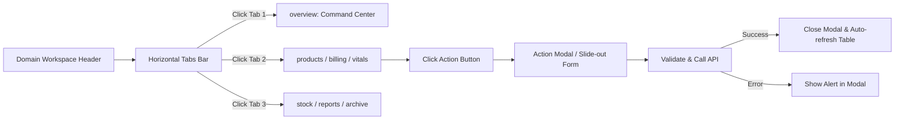
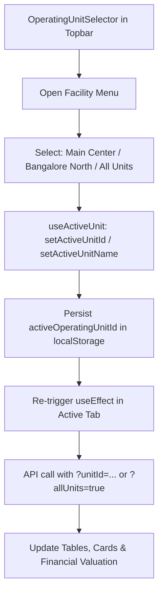

# ERP PHASE 01 — NAVIGATION & INTERACTION MAP

**Project:** ElderCare Enterprise ERP (Universal Nature Care & Cure Foundation — UNCF)  
**Application:** `superadminapp`  
**Status Baseline:** VERIFIED from router logic, auth guards, and interaction handlers

---

## 1. USER AUTHENTICATION & SESSION FLOW

```mermaid
flowchart TD
    Start([User visits /]) --> CheckAuth{Has Valid Session Token?}
    CheckAuth -- No --> LoginPage[/login]
    LoginPage --> SubmitLogin[Submit Email & Password]
    SubmitLogin --> AuthAPI[POST /api/v1/auth/login]
    AuthAPI -- Invalid --> ShowError[Display Inline Error Alert]
    AuthAPI -- Temporary Password --> ForcePW[/change-temporary-password]
    ForcePW --> SubmitNewPW[Submit New Password] --> UpdateAuth[Update Credentials] --> ResolveRole
    AuthAPI -- Valid --> StoreTokens[Store Bearer Token & User Profile in localStorage]
    StoreTokens --> ResolveRole{Resolve User Role & Permissions}
    CheckAuth -- Yes --> ResolveRole

    ResolveRole -- SUPER_ADMIN / DIRECTOR --> DashboardRoute[/dashboard]
    ResolveRole -- STORE_MANAGER / PROCUREMENT --> InventoryRoute[/inventory]
    ResolveRole -- DOCTOR / HEAD_NURSE / CAREGIVER --> InhouseCareRoute[/inhouse-care]
    ResolveRole -- FINANCE_CONTROLLER / ACCOUNTANT --> FinanceRoute[/finance]
    ResolveRole -- ADMISSION_COUNSELOR --> AdmissionRoute[/admission]
    ResolveRole -- SECURITY_GUARD --> SecurityRoute[/visitor-security]
    ResolveRole -- HR_MANAGER --> HRRoute[/hr-operations]
    ResolveRole -- AMBULANCE_DRIVER --> AmbulanceRoute[/ambulance]
    ResolveRole -- CRM_AGENT / TELECALLER --> CRMRoute[/crm/agent/dashboard]
    ResolveRole -- FAMILY_SPONSOR --> PortalRoute[/portal]
```

---

## 2. WORKSPACE TAB & MODAL NAVIGATION FLOW

Within every business domain workspace, navigation is driven by query parameters (`?tab=...`), ensuring that users can refresh the browser, share links, and use browser back/forward buttons without losing their active screen.



---

## 3. FACILITY OPERATING SCOPE SWITCHING



---

## 4. CROSS-DOMAIN WORKFLOW TRANSITIONS

The ERP integrates data pipelines between operational departments:
1. **Admissions -> Clinical Care:** When resident intake completes at `/admission?tab=new`, clinical profile is instantiated at `/inhouse-care?tab=daily-ops`.
2. **Clinical Care -> Central Inventory:** When ward nurse indents medicines at `/inhouse-care?tab=medicine-requests`, warehouse requisition appears at `/inventory?tab=issues`.
3. **Inventory Procurement -> Finance Accounts Payable:** When warehouse manager inspects goods at `/inventory?tab=purchases` (GRN), accrual record is sent to `/finance?tab=grn-accruals`.
4. **Clinical Care -> Finance Resident Billing:** When specialized medical procedures are administered, revenue line-items are transferred to `/finance?tab=billing`.
